# Hi, I'm Ayşenur! 👋

### 💻 Computer Engineer | Robotics & Software Developer

I'm interested in developing software for robotics, autonomous systems, UAVs and web applications. I enjoy building projects that combine software, hardware and intelligent systems.

---

### 🛠️ Technologies & Tools

**Programming Languages**

**Robotics & Autonomous Systems**

**Web Development**

**Tools & Platforms**

---

### 🚀 Areas of Interest

- Robotics and Autonomous Systems
- UAV / Drone Software Development
- Autonomous Navigation and Flight Control
- Embedded Systems
- Computer Vision and Image Processing
- Simulation and Software Integration
- Full-Stack Web Development

---

### 📌 Featured Projects

**Autonomous UAV – Teknofest Savaşan İHA**
- Autonomous flight development
- ArduPilot integration
- Mission planning and telemetry
- Gazebo simulation

**Ground Control Station (GCS)**
- React-based ground control interface
- Real-time telemetry visualization
- MAVLink communication
- UAV camera stream integration

**Web Development Projects**
- Next.js applications
- Firebase integration
- Responsive user interfaces

---

### 📊 GitHub Stats

  
  

---

### 👾 Contribution Activity

<picture>
  <source media="(prefers-color-scheme: dark)" srcset="https://raw.githubusercontent.com/aysenurgulsum/aysenurgulsum/output/pacman-contribution-graph-dark.svg">
  <source media="(prefers-color-scheme: light)" srcset="https://raw.githubusercontent.com/aysenurgulsum/aysenurgulsum/output/pacman-contribution-graph.svg">
  
</picture>

_👻 Pac-Man is chasing contributions!_

---

  Thanks for visiting my profile! ⭐

